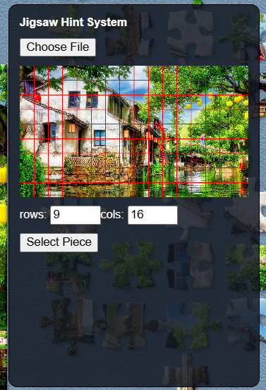
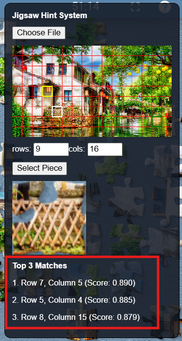

# Jigsaw Explorer Hint System

A JavaScript userscript for [Jigsaw Explorer](https://www.jigsawexplorer.com/) using **Tampermonkey and OpenCV.js** to identify the likely positions of scattered puzzle pieces

## Features
- Upload the original puzzle image
- Adjust puzzle rows and columns manually
- Select and capture scattered puzzle pieces
- Match selected pieces against the reference image using OpenCV.js
- Highlight the top 3 matching positions with similarity scores
- Draggable hint panel

## Requirements
- Google Chrome
- Tampermonkey Chrome extension
- Internet connection for OpenCV.js

## Installation
1. Install the Tampermonkey Chrome extension
2. Create two separate userscripts in Tampermonkey
3. Copy and paste `jigsaw-hint-system.js` and `jigex-preserve-buffer.js` into separate scripts
4. Save and enable both scripts
5. Open Jigsaw Explorer and refresh the webpage

## How to Use
1. Press `Ctrl + Shift + J` -> **Network** -> **Img**, reload the page and download the original `.jpg` image (without `-bc`)
2. Click **Choose File** to upload the downloaded image
3. Manually enter the puzzle's rows and columns
4. Click **Select Piece** and draw a rectangle around a scattered puzzle piece
5. View the cropped piece, top 3 highlighted grid cells and similarity scores in the hint panel

## Screenshots

### Hint Panel

  

### Matching Results

  

## Limitations
- Rows and columns must be counted manually
- Matching accuracy depends on the selected region and image alignment
- Unable to locate scattered pieces by selecting a reference grid cell
- Does not automatically move puzzle pieces
